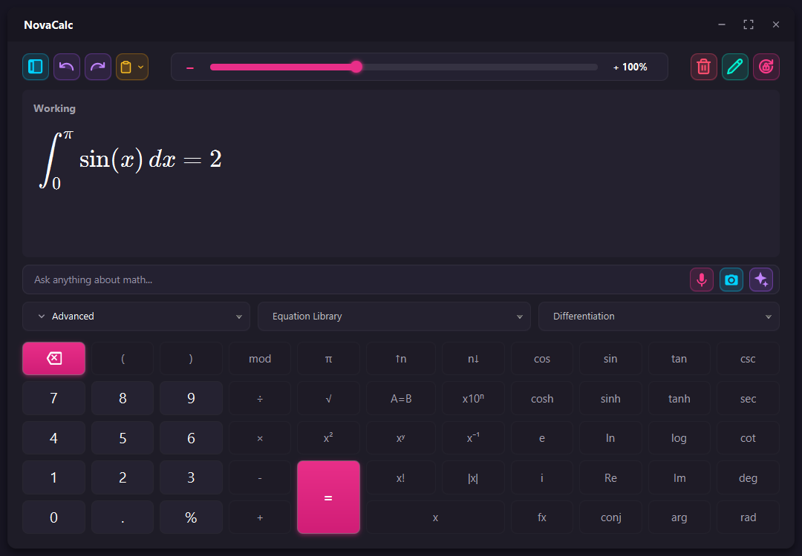
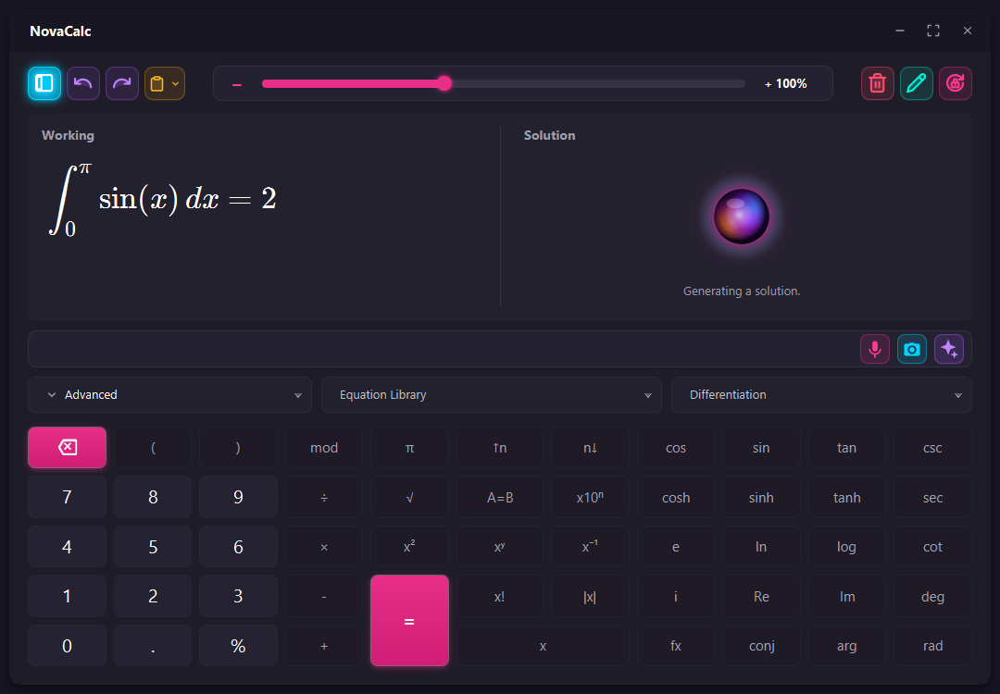
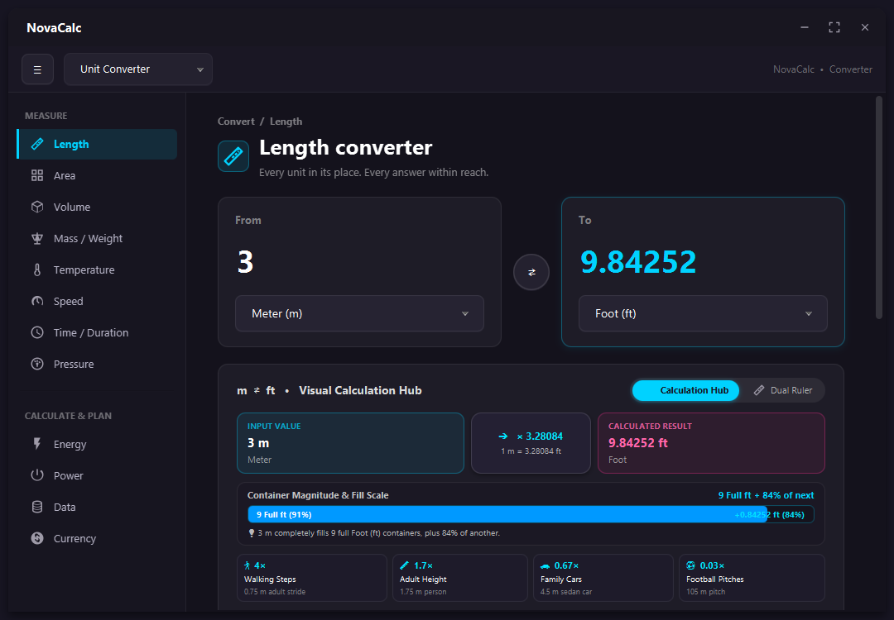
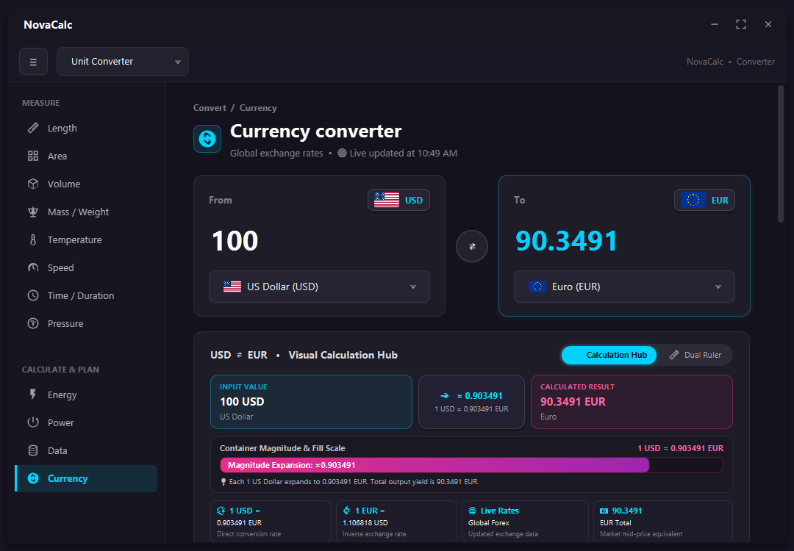
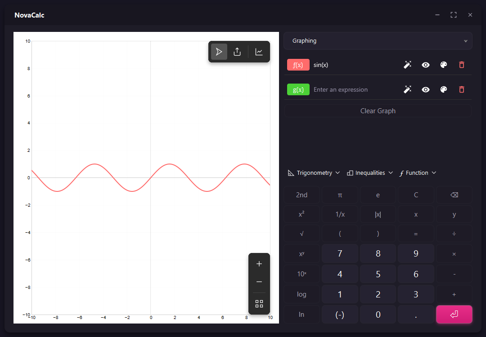

# NovaCalc — Advanced Scientific & AI Calculator

[](https://openjdk.org/)
[](https://openjfx.io/)
[](https://ai.google.dev/)
[](https://maven.apache.org/)
[](LICENSE)

**NovaCalc** is a next-generation desktop scientific calculator and mathematical workstation engineered with **JavaFX**, **KaTeX typesetting**, and **Google Gemini AI**. Designed with a modern dark glassmorphic interface, NovaCalc combines traditional high-precision algebraic calculation with multimodal math inputs, interactive 2D function graphing, a comprehensive visual unit converter, calculus engines, and real-time step-by-step AI math tutoring.

<p align="center">
  
</p>

---

## Table of Contents

- [Key Features](#-key-features)
  - [1. Advanced Mathematical Engine](#1-advanced-mathematical-engine)
  - [2. AI Step-by-Step Solver](#2-ai-step-by-step-solver)
  - [3. Visual Unit Converter](#3-visual-unit-converter)
  - [4. Multimodal Math Input](#4-multimodal-math-input)
  - [5. Interactive 2D Graphing](#5-interactive-2d-graphing)
  - [6. Calculus & Equation Libraries](#6-calculus--equation-libraries)
- [Project Architecture & File Structure](#-project-architecture--file-structure)
- [Prerequisites](#-prerequisites)
- [Quick Start & Running](#-quick-start--running)
- [Building & Deployment](#-building--deployment)
  - [Building the Standalone Executable JAR](#building-the-standalone-executable-jar)
  - [Running the Shaded JAR](#running-the-shaded-jar)
  - [One-Click Runner Scripts](#one-click-runner-scripts)
- [AI Configuration & Security](#-ai-configuration--security)
- [Keyboard Shortcuts](#-keyboard-shortcuts)
- [Contributing & License](#-contributing--license)

---

## 🌟 Key Features

### 1. Advanced Mathematical Engine
- **High-Precision Arithmetic**: Handles nested parentheses, trigonometric (`sin`, `cos`, `tan`, `csc`, `sec`, `cot`), hyperbolic (`sinh`, `cosh`, `tanh`), logarithmic (`ln`, `log`), roots, powers, factorials (`x!`, `n!`), percent, and constants ($\pi$, $e$).
- **LaTeX Math Rendering**: Displays expressions and solutions via bundled KaTeX with full typography, mathematical symbols, and syntax formatting.
- **Window Management**: Window pinning (Always-on-Top), undo/redo expression history, and full window maximization responsiveness.

### 2. AI Step-by-Step Solver
- **Google Gemini Integration**: Provides comprehensive step-by-step algebraic derivations, verification rules, and explanations.
- **Hardware-Accelerated Animated AI Orb**: Custom multi-layer chromatic glowing canvas sphere (`AIOrbView`) with pulsating aura and breathing scale.
- **Live Status Stream**: Animated typewriter effect that rotates through calculation steps (`"Generating a solution..."`, `"Analyzing mathematical logic..."`, `"Formulating step-by-step steps..."`) with pulsing animated dots.
- **Offline Fallback**: Automatically falls back to native calculation when offline or when no API key is configured.

<p align="center">
  
</p>

### 3. Visual Unit Converter
- **12 Comprehensive Measurement Categories**:
  - *Measure:* Length, Area, Volume, Mass / Weight, Temperature, Speed, Time / Duration, Pressure
  - *Calculate & Plan:* Energy, Power, Data, Currency
- **Visual Calculation Hub & Interactive Dual Ruler**:
  - Dual-Ruler dynamic scale showing relative unit proportions with tick marks.
  - Container Magnitude and Fill visualizer showing fill percentages and container ratios.
  - Real-world benchmark cards (e.g. Walking Steps, Adult Heights, Olympic Swimming Pools, Cargo Containers, Basketball Courts, Tesla Model S Battery, etc.).
- **Live Currency Exchange Rates**:
  - Real-time exchange rate updates with 24-hour caching and offline fallback.
  - National country flags rendered beside currency cards (USD, EUR, GBP, JPY, CAD, AUD, CHF, CNY, BRL, LKR, etc.).
- **Conversion History**:
  - Searchable timestamped conversion log with single-click copy buttons and a quick "Clear All" action.

<p align="center">
  
</p>

<p align="center">
  
</p>

### 4. Multimodal Math Input
- **Speech-to-Math (Voice Input)**: Dictate formulas naturally via microphone; spoken math expressions are automatically parsed and translated into LaTeX.
- **Camera & Screenshot OCR**: Scan math problems directly using your webcam, screenshot snipper tool (`ScreenSnipper`), or drag-and-drop image file onto the calculator.

### 5. Interactive 2D Graphing
- Embedded D3.js & FunctionPlot graphing canvas.
- Multi-function plotting with customized styles (solid, dashed, dotted lines).
- Interactive mouse panning, mouse-wheel zooming, coordinate tracing, and domain controls ($[-10, 10]$).

<p align="center">
  
</p>

### 6. Calculus & Equation Libraries
- **Calculus Engine**:
  - Derivatives ($\frac{d}{dx}$), Second Derivatives ($\frac{d^2}{dx^2}$), Partial Derivatives ($\frac{\partial}{\partial x}$)
  - Indefinite & Definite Integrals ($\int$, $\int_{a}^{b}$, $\iint$)
  - Limits ($\lim_{x \to 0}$, $\lim_{x \to \infty}$)
  - Summations ($\sum_{i=1}^n$) and Products ($\prod_{i=1}^n$)
- **Pre-Configured Physics & Math Library**:
  - Pythagorean Theorem, Quadratic Formula, Newton's 2nd Law, Ideal Gas Law, Circle/Sphere Geometry, Euler's Identity, Schrödinger Equation, and more.

---

## 📁 Project Architecture & File Structure

```
AdvancedCalculator/
├── src/
│   ├── main/
│   │   ├── java/com/banukasineth/advancedcalculator/app/
│   │   │   ├── Main.java                          # Standalone application entrypoint (Fat JAR launcher)
│   │   │   ├── CalculatorApplication.java         # JavaFX Application lifecycle & stage config
│   │   │   ├── controller/
│   │   │   │   ├── CalculatorController.java      # Main calculator logic, state, and UI binding
│   │   │   │   └── UnitConverterController.java   # Unit converter, live rates, visual simulators
│   │   │   ├── service/
│   │   │   │   ├── AIConfigManager.java           # Secure API key preferences management
│   │   │   │   ├── AISolverService.java           # Gemini API client & math prompt orchestration
│   │   │   │   ├── CameraMathService.java         # OCR image math extraction service
│   │   │   │   └── VoiceInputService.java          # Audio recording & speech transcription
│   │   │   ├── ui/
│   │   │   │   ├── AIOrbView.java                 # Canvas-based hardware-accelerated animated AI orb
│   │   │   │   ├── AISettingsDialog.java          # Gemini API key and model selection modal
│   │   │   │   ├── CameraScannerDialog.java       # Webcam camera scanning modal
│   │   │   │   ├── EquationSubstitutionDialog.java# Interactive formula parameter substitution
│   │   │   │   └── ScreenSnipper.java             # Desktop screen region capture tool
│   │   │   └── util/
│   │   │       └── MathEvaluator.java             # High-precision expression parser & evaluator
│   │   └── resources/
│   │       ├── css/
│   │       │   └── style.css                      # Glassmorphic dark theme stylesheet
│   │       ├── fxml/
│   │       │   ├── Main.fxml                      # Primary calculator layout & toolbars
│   │       │   ├── NavigationDrawer.fxml          # Left slide-out navigation menu
│   │       │   ├── ScientificKeypad.fxml          # Keypad layouts
│   │       │   └── UnitConverter.fxml             # Integrated responsive converter layout
│   │       ├── html/
│   │       │   ├── formula_display.html           # KaTeX equation substitution renderer
│   │       │   ├── graph_display.html             # D3 & FunctionPlot 2D graphing webview
│   │       │   ├── math_display.html              # Primary expression KaTeX display
│   │       │   └── solution_display.html          # AI step-by-step KaTeX solution display
│   │       ├── images/flags/                      # SVG/PNG national flags for currency converter
│   │       ├── js/                                # D3.js and FunctionPlot JavaScript libraries
│   │       └── katex/                             # Bundled offline KaTeX engine, fonts, & styles
│   └── test/java/                                 # Unit & service integration verification tests
├── pom.xml                                        # Maven project configuration with Shade plugin
├── run.bat                                        # 1-Click Windows execution script
├── run.sh                                         # 1-Click macOS / Linux execution script
├── config.properties.example                      # Example configuration template for API keys
├── .gitignore                                     # Comprehensive exclusion rules
└── README.md                                      # Project documentation
```

---

## 💻 Prerequisites

- **Java Development Kit (JDK)**: JDK 17, 21, or 25 (LTS recommended)
- **Apache Maven**: Version 3.8 or higher (or use IntelliJ IDEA's bundled Maven)
- **Operating System**: Windows 10/11, macOS 11+, or Linux (with GTK3/Webkit support)

---

## ⚡ Quick Start & Running

### Option 1: Run via Maven Plugin
```bash
mvn clean compile javafx:run
```

### Option 2: 1-Click Execution Scripts
- **Windows**: Double-click `run.bat` or run:
  ```cmd
  run.bat
  ```
- **Linux / macOS**:
  ```bash
  chmod +x run.sh
  ./run.sh
  ```

### Option 3: Run from IntelliJ IDEA / Eclipse
1. Open the project directory in your IDE.
2. Select **Project SDK**: JDK 17, 21, or 25.
3. Locate `src/main/java/com/banukasineth/advancedcalculator/app/Main.java`.
4. Right-click and choose **Run 'Main.main()'**.

---

## 📦 Building & Deployment

### Building the Standalone Executable JAR
NovaCalc is configured with `maven-shade-plugin` to assemble a fully self-contained fat JAR bundling all JavaFX runtime components, fonts, KaTeX assets, and dependencies:

```bash
mvn clean package -DskipTests
```

This creates:
- `target/NovaCalc.jar` (Standalone executable uber-JAR, ~46 MB)

### Running the Shaded JAR
The standalone JAR can be executed directly on any machine with Java installed, without needing JavaFX SDKs or `--module-path` parameters:

```bash
java -jar target/NovaCalc.jar
```

Or simply double-click `NovaCalc.jar` in your file explorer.

---

## 🔑 AI Configuration & Security

NovaCalc is secure by default: **no private API keys or personal credentials are included in the repository**.

To enable Gemini-powered step-by-step explanations:

### Method A: In-App Dialog (Recommended)
1. In the NovaCalc toolbar, click the **AI Sparkles (✨)** button.
2. Paste your API key from [Google AI Studio](https://aistudio.google.com/app/apikey).
3. Select your preferred model (`gemini-2.5-flash`, `gemini-2.5-pro`, or `gemini-1.5-flash`).
4. Click **Test Connection** and then **Save & Apply**.
   *(Keys are saved locally in private user preferences and are never tracked by Git.)*

### Method B: `config.properties` File
1. Copy the example template:
   ```bash
   cp config.properties.example config.properties
   ```
2. Open `config.properties` and provide your credentials:
   ```properties
   gemini.api.key=YOUR_API_KEY_HERE
   gemini.model.name=gemini-2.5-flash
   ```

### Method C: System Environment Variable
```bash
# Windows (PowerShell)
$env:GEMINI_API_KEY="your-api-key"

# Linux / macOS (Bash / Zsh)
export GEMINI_API_KEY="your-api-key"
```

---

## ⌨️ Keyboard Shortcuts

| Shortcut | Action |
|:---|:---|
| `0` - `9`, `.` | Enter numbers and decimal point |
| `+`, `-`, `*`, `/` | Basic arithmetic operators |
| `Enter` or `=` | Evaluate expression |
| `Backspace` | Delete last character |
| `Delete` or `Esc` | Clear display / Working memory |
| `Ctrl + Z` | Undo last operation |
| `Ctrl + Y` | Redo operation |
| `Ctrl + +` / `Ctrl + -` | Zoom In / Zoom Out in Graphing Mode |
| `Ctrl + 0` | Reset Graph Zoom |
| `Alt + S` | Toggle Right Solution Panel |

---

## 📄 License

This project is licensed under the MIT License — see the [LICENSE](LICENSE) file for details.
All bundled KaTeX resources are subject to their respective open-source licenses (MIT/SIL OFL).
